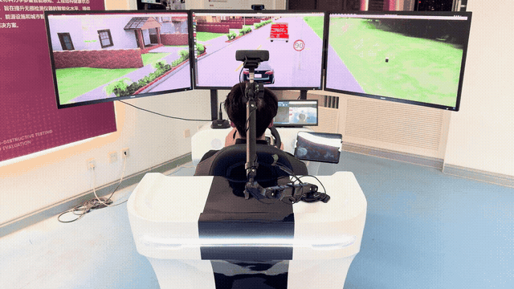
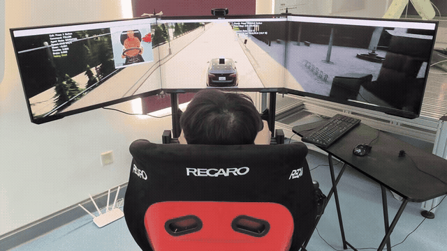

  

# 人机共驾强化学习与驾驶座舱实验平台

**北京市自然科学基金项目：人机共驾强化学习决策优化研究 · 学生骨干**  
何非凡 · 北京工业大学 · 控制科学与工程

围绕不完美人类示范下的策略学习问题，我独立完成两代驾驶座舱的工程搭建与迭代，开展轨迹质量评估、反事实接管筛选和质量引导的强化学习研究，实现从硬件集成、人机交互到算法部署与实验评估的完整流程。

**[第二代座舱演示](#第二代座舱外观升级与算法验证)** · **[第一代座舱演示](#第一代座舱从零搭建人在回路平台)** · **[实验结果](#实验结果)** · **[返回 VLA 项目主页 ↗](https://ml6362662.github.io/ml6362662/)**

> 本仓库展示座舱平台、研究概览与演示视频。论文在投，暂不公开全文、算法代码及详细实现。

## 我的工作

| 能力 | 具体工作 |
| --- | --- |
| **硬件动手与系统集成** | 独立完成商家对接、设备选型、硬件安装与座舱集成，迭代两代平台。 |
| **软件开发与模型部署** | 独立完成软件部署和代码开发，连接方向盘、踏板、多屏显示与 CARLA，实现人工接管和策略运行。 |
| **强化学习方法研究** | 设计研究框架，围绕示范质量与接管必要性开展算法研究，实现质量引导的 TD3 学习。 |
| **实验闭环** | 完成示范采集、策略训练、模型部署与仿真评估，将真实操作设备与学习算法接入同一实验系统。 |

## 第二代座舱：外观升级与算法验证

**[▶ 打开完整演示（约 57 秒，含声音）](https://github.com/ml6362662/hil-driving-cockpit/raw/refs/heads/main/assets/cockpit-v2.mp4)** · [视频文件](assets/cockpit-v2.mp4)

在第一代平台基础上，我独立完成系统迭代与软硬件部署，将座舱从基础实验装置升级为更完整的人机交互科研平台。

- **外观与结构升级：** 迭代座舱外观，相关成果获得“具身交互智能驾驶座舱”外观设计专利。
- **四屏信息呈现：** 三块屏幕展示驾驶仿真视野，第四块屏幕展示驾驶员面部检测信息。
- **算法部署验证：** 接入当前论文对应的方法，完成从人类接管、数据评估到策略更新与部署验证的闭环。
- **系统集成经验：** 将操控设备、仿真环境、驾驶员检测与强化学习算法整合到可运行的平台中。

第四块屏幕用于辅助信息展示；驾驶员面部检测与下面的核心强化学习方法分开介绍。

## 第一代座舱：从零搭建人在回路平台

**[▶ 打开完整演示（约 28 秒，含声音）](https://github.com/ml6362662/hil-driving-cockpit/raw/refs/heads/main/assets/cockpit-v1.mp4)** · [视频文件](assets/cockpit-v1.mp4)

从联系商家、设备选型、硬件安装，到软件部署和代码开发，全流程由我独立完成。

- **铝材座舱搭建：** 使用铝材构建座舱，安装三块屏幕，形成多视角的高保真驾驶仿真展示。
- **操控设备接入：** 使用 Logitech G920 方向盘与踏板控制 CARLA 中的车辆，打通硬件输入与仿真交互。
- **算法基础建设：** 设计整体研究框架，构建多维轨迹质量评估的基础框架，实现人工接管控制与人类偏好学习。
- **驾驶员状态展示：** 配置基础疲劳与情绪检测功能，对驾驶员面部表情进行简单识别和反馈。

这一阶段建立了后续强化学习研究所需的平台、采集与交互基础。

## 方法概览

研究关注一个问题：**人类接管不一定都同样有用，如何让策略从不完美示范中学习更有价值的行为？**

1. **多维轨迹质量评估：** 从安全性、舒适性与驾驶效率三个维度评价驾驶轨迹，为不同质量的示范提供区分依据。
2. **反事实接管筛选：** 基于接管时刻的冻结策略与运动学模型，估计未发生接管时的自主驾驶表现，再与人类表现比较，判断这段接管是否值得用于学习。
3. **质量引导的 TD3 学习：** 将轨迹质量信息引入价值学习，使有益且质量更高的人类示范提供更有效的训练指导。

## 实验结果

在论文所述的 **CARLA 仿真评估**中，相较 PVP 基线：

| 指标 | PVP 基线 | 本方法 |
| --- | ---: | ---: |
| **成功率** | **44%** | **80%** |
| **路线完成率** | **67%** | **92%** |

结果来自当前在投稿件。演示视频用于展示平台与交互过程；上述指标来自论文评测，适用范围为其仿真任务设置。

## 从驾驶座舱研究到 VLA 真机后训练

我的研究主线是：**如何利用人类反馈与交互数据，让策略学得更好，并在实际系统中完成闭环验证。**

座舱科研工作让我建立了强化学习、价值函数设计、人类示范利用和系统部署的基础。后续将实验对象从驾驶仿真拓展到机器人操作，在 VLA 真机任务中继续研究人类接管纠错、数据质量与策略后训练。

| 座舱研究积累 | 在具身智能工作中的延伸 |
| --- | --- |
| 人工接管与示范采集 | VR 遥操作、DAgger 式纠错数据采集 |
| 示范质量与接管价值判断 | 关注纠错数据对当前策略的实际学习价值 |
| TD3 价值学习与策略优化 | 理解并复现 VLA 离线后训练，开展 STEAM + CFG 真机适配 |
| 硬件集成与算法闭环部署 | Quest 3—xArm 采训推系统搭建与真机评估 |

反事实评估也与具身领域 World Model 的应用思路相通：利用模型推演辅助判断行为及数据的价值。本项目采用轻量运动学模型，这一联系体现为研究思想的延伸，不将其等同于已训练通用学习式 World Model。

这是一条从**强化学习方法研究 → 人机交互系统实践 → VLA 真机后训练**逐步深入的路线，学习问题与方法积累具有连续性。

**[查看我的 VLA 真机项目：xArm 采训推与多目标后训练 ↗](https://ml6362662.github.io/ml6362662/)**

## 论文与外观设计成果

**论文：** *Quality-Guided Human-in-the-Loop Reinforcement Learning for Autonomous Driving with Imperfect Human Demonstrations*  
作者：Nan Ma、Feifan He、Yajue Yang、Yunhan Mao。  
状态：IEEE TVT 在投；本仓库仅展示概览与两项结果，不公开论文全文。

**外观设计专利：** 具身交互智能驾驶座舱  
专利号：**ZL 2025 3 0418087.3**  
授权公告号：CN 309867138 S；授权公告日：2026 年 3 月 24 日。  
专利权人：北京工业大学。设计人：马楠、何非凡、杨雅珏、韩天聪。

平台工程的个人贡献与论文、专利的署名分别列示。外观设计专利对应座舱外观，不代表对上述算法方法的专利授权。

---

[何非凡 · GitHub](https://github.com/ml6362662) · [VLA 真机实验主页](https://ml6362662.github.io/ml6362662/)
